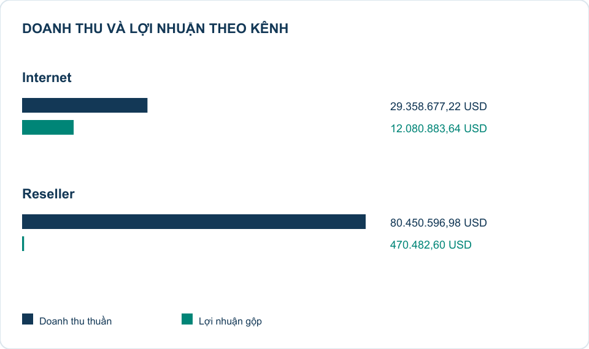
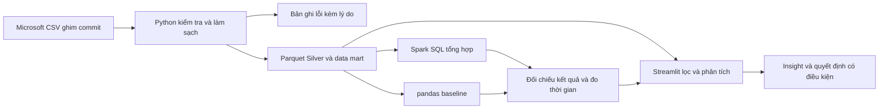

# RetailInsight — Multi-Channel Revenue and Profit Analytics

**Phân tích doanh thu và lợi nhuận bán lẻ đa kênh — CO4033, đề tài 01.**

Dự án xây dựng quy trình từ dữ liệu nguồn đến dashboard phục vụ quản lý bán hàng và tài chính. Hai câu hỏi chính: kênh doanh thu cao có đồng thời sinh lợi cao không; danh mục và vùng nào đáng ưu tiên kiểm tra để cải thiện hiệu quả?

Pipeline nạp dữ liệu Microsoft AdventureWorksDW, kiểm tra chất lượng, tạo data mart Parquet, tổng hợp bằng Spark SQL và đối chiếu với pandas. Dashboard Streamlit cho phép lọc và tải kết quả phân tích bằng tiếng Việt.

**Lưu ý nguồn:** AdventureWorks là dữ liệu doanh nghiệp **giả lập** do Microsoft cung cấp, giấy phép MIT. Kết quả dùng cho học tập và kiểm chứng kỹ thuật, không đại diện thị trường thực tế.

[Báo cáo PDF](output/Bao_cao_pipeline_dashboard.pdf) · [Báo cáo đọc trên GitHub](docs/BAO_CAO.md) · [Nguồn dữ liệu và link tải](docs/DATA_SOURCES.md) · [Đối chiếu yêu cầu](docs/REQUIREMENTS.md) · [Demo](docs/DEMO.md)

## Dashboard

- **Tổng quan:** doanh thu, lợi nhuận gộp, biên gộp, tăng trưởng tháng, xu hướng và nhận xét theo bộ lọc.
- **Kênh và thị trường:** so sánh Internet/Reseller, hiệu quả vùng, bảng và CSV bằng USD.
- **Sản phẩm:** tìm theo danh mục, xếp hạng lợi nhuận cao/thấp, giữ cả sản phẩm lỗ.
- **Dữ liệu và kiểm chứng:** chất lượng trước–sau, benchmark, công thức và truy vết nguồn.

Thanh bên có lựa chọn **Tất cả**, khoảng ngày, kỳ chung hai kênh, bộ lọc kênh/vùng/danh mục và tìm sản phẩm. Thay đổi bộ lọc cập nhật đồng thời KPI, biểu đồ, bảng và CSV. Có nút đặt lại; dữ liệu rỗng hoặc ngày đảo chiều được xử lý rõ ràng.

## Chạy nhanh

Yêu cầu: **Python 3.11 hoặc 3.12**, **JDK 17+**, `JAVA_HOME` trỏ đến JDK. Không cần SQL Server, SSMS, Docker, Hadoop/HDFS, Power BI hoặc tài khoản Kaggle.

### Windows

```powershell
python -m venv .venv
.\.venv\Scripts\python.exe -m pip install --no-cache-dir -r requirements.txt
.\run.cmd all
.\run.cmd dashboard
```

Mở **http://127.0.0.1:8501**. Nếu đã có dữ liệu và môi trường, chỉ cần `run.cmd dashboard`.

`run.cmd` dùng được khi PowerShell chặn script `.ps1`; không cần đổi execution policy. Kiểm tra `JAVA_HOME` bằng `echo $env:JAVA_HOME`; Spark dùng JDK tại biến này. Nên dành khoảng 3 GB dung lượng trống cho cài đặt và file tạm.

### Linux và macOS

```bash
python3 -m venv .venv
source .venv/bin/activate
python -m pip install -r requirements.txt
python -m retail_bi.pipeline --download
python -m retail_bi.benchmark --repeats 3
python -m retail_bi.report
python -m retail_bi.delivery --verify --package
python -m streamlit run dashboard.py
```

Xuất PDF tiếng Việt cần Arial trên Windows hoặc DejaVu Sans trên Linux (`fonts-dejavu-core`). macOS có thể cung cấp cặp font hợp lệ trong `assets/fonts/`; xem hàm `register_fonts` trong `retail_bi/report.py`.

## Dataset và kết quả toàn kỳ

[**Mở dataset chính thức của Microsoft**](https://github.com/microsoft/sql-server-samples/tree/b47eadc85277f72843647223cde53aa1b85ffcb8/samples/databases/adventure-works/data-warehouse-install-script)

Nguồn được ghim commit `b47eadc85277f72843647223cde53aa1b85ffcb8`: 8 bảng, **121.253 dòng bán hàng**, **31.455 đơn**, từ **29/12/2010 đến 28/01/2014**. Script tự tải CSV; không phải tải hoặc khôi phục file `.bak`.

| Chỉ số | Giá trị |
|---|---:|
| Doanh thu sau chiết khấu | 109.809.274,2030 USD |
| Giá vốn | 97.257.907,9547 USD |
| Lợi nhuận gộp | 12.551.366,2483 USD |
| Biên lợi nhuận gộp | 11,430151% |
| Tăng trưởng 10/2013 so với 09/2013 | +36,4968% |



*Hình tổng hợp được sinh trực tiếp từ data mart, không phải ảnh chụp giao diện.*

Reseller kết thúc ghi nhận ngày 29/11/2013, Internet ngày 28/01/2014. KPI tăng trưởng chỉ dùng cặp tháng nằm trọn trong phạm vi nguồn của kênh đang chọn và khoảng lọc. Không diễn giải mức giảm ở biên dataset thành suy giảm nhu cầu. Cờ đủ kỳ chỉ xét biên thời gian, không bảo đảm nguồn không bỏ sót giao dịch.

## Kiến trúc



Mart có grain **một dòng mặt hàng trong đơn**. Khóa gồm kênh, số đơn và số dòng. Ghép chiều nhiều-một có kiểm tra; không cho phép nhân đôi doanh thu. Mỗi lần nạp tạo run riêng, chỉ công bố `current.txt` sau khi hoàn tất. Lỗi nạp không thay thế lượt thành công trước đó.

## Công thức KPI

| KPI | Công thức |
|---|---|
| Doanh thu thuần | SUM(SalesAmount); nguồn đã trừ DiscountAmount |
| Lợi nhuận gộp | SUM(SalesAmount − TotalProductCost) |
| Biên gộp | Tổng lợi nhuận gộp / tổng doanh thu × 100 |
| Tăng trưởng tháng | (Doanh thu tháng / doanh thu tháng lịch trước − 1) × 100 |

Tiền giữ bằng số nguyên **1/10.000 USD**, chỉ làm tròn khi hiển thị. Không trừ chiết khấu hai lần, không lấy trung bình biên từng dòng, không loại giao dịch lỗ. Mẫu số 0 hoặc chưa có kỳ trước trả về không xác định. Lợi nhuận gộp chưa trừ marketing/vận hành; nguồn không có hoàn trả để điều chỉnh thêm.

## Tái lập thực nghiệm

```powershell
.\run.cmd pipeline     # tải nếu thiếu, kiểm tra, tạo mart
.\run.cmd benchmark    # 3 workload × 3 lần × 2 công cụ
.\run.cmd load-test    # tùy chọn: 5 bản sao để thử tải
.\run.cmd test         # kiểm thử và lưu log
.\run.cmd report       # PDF và hình tổng hợp từ dữ liệu hiện hành
.\run.cmd package      # minh chứng và ZIP sẵn sàng kiểm tra trước khi publish
```

Benchmark dùng cùng Parquet, cùng cột và phép tổng hợp; mốc đo gồm đọc, tổng hợp, distinct, sắp xếp và trả kết quả. Khởi động JVM đo riêng; không loại lượt đầu và không xóa cache hệ điều hành. Kết quả được so sánh chính xác **từng nhóm**, không chỉ tổng chung.

Trong lượt đo bàn giao, pandas nhanh hơn Spark SQL ở cả dữ liệu gốc và tải mô phỏng 5×. Không kết luận Spark luôn chậm hơn hoặc hệ thống đã đạt quy mô Big Data. Các con số và cấu hình nằm tại [output/evidence](output/evidence); chạy lại có thể cho thời gian khác. Dữ liệu thử tải được tách khỏi phân tích kinh doanh.

## Cấu trúc

```text
dashboard.py               giao diện Streamlit
assets/dashboard.css       giao diện và bố cục thích ứng
.streamlit/config.toml     chủ đề và cấu hình local
retail_bi/pipeline.py       tải nguồn, chất lượng, mart, lineage
retail_bi/analytics.py      bộ lọc, KPI tháng, tổng hợp, CSV
retail_bi/benchmark.py      Spark SQL và baseline
retail_bi/report.py         báo cáo PDF và hình dữ liệu
retail_bi/delivery.py       log kiểm thử, minh chứng và ZIP
sql/retail/                SQL tổng hợp và phân khúc
tests/                     kiểm thử đơn vị và tích hợp
docs/                      báo cáo, nguồn, demo, hướng dẫn GitHub
output/                    báo cáo PDF, minh chứng và ZIP local
data/adventureworks/       nguồn và warehouse, không đưa lên Git
```

## Kiểm chứng và hồ sơ GitHub

Kiểm thử bao gồm tiền/chiết khấu, giao dịch lỗ, khóa và phép ghép, tháng trống, phạm vi kỳ tăng trưởng, CSV, thay đổi bộ lọc, reset, dữ liệu rỗng, Spark thực, PDF và gói bàn giao. Chi tiết: [docs/VALIDATION.md](docs/VALIDATION.md).

Có cấu hình GitHub Actions tại `.github/workflows/ci.yml`; kiểm tra kết quả trên đúng commit sau khi push. Repository: [winter-1402/RetailInsight](https://github.com/winter-1402/RetailInsight-Multi-Channel-Revenue-and-Profit-Analytics). Quy trình làm việc theo nhánh: [docs/GITHUB.md](docs/GITHUB.md). ZIP loại dữ liệu thô, môi trường ảo, cache, thông tin Git và tài liệu giao đề gốc.

Giấy phép mã: [MIT](LICENSE). Nguồn và giấy phép bên thứ ba: [THIRD_PARTY_NOTICES.md](THIRD_PARTY_NOTICES.md). Công cụ AI và trách nhiệm học thuật được công khai ở [docs/AI_USAGE.md](docs/AI_USAGE.md).
